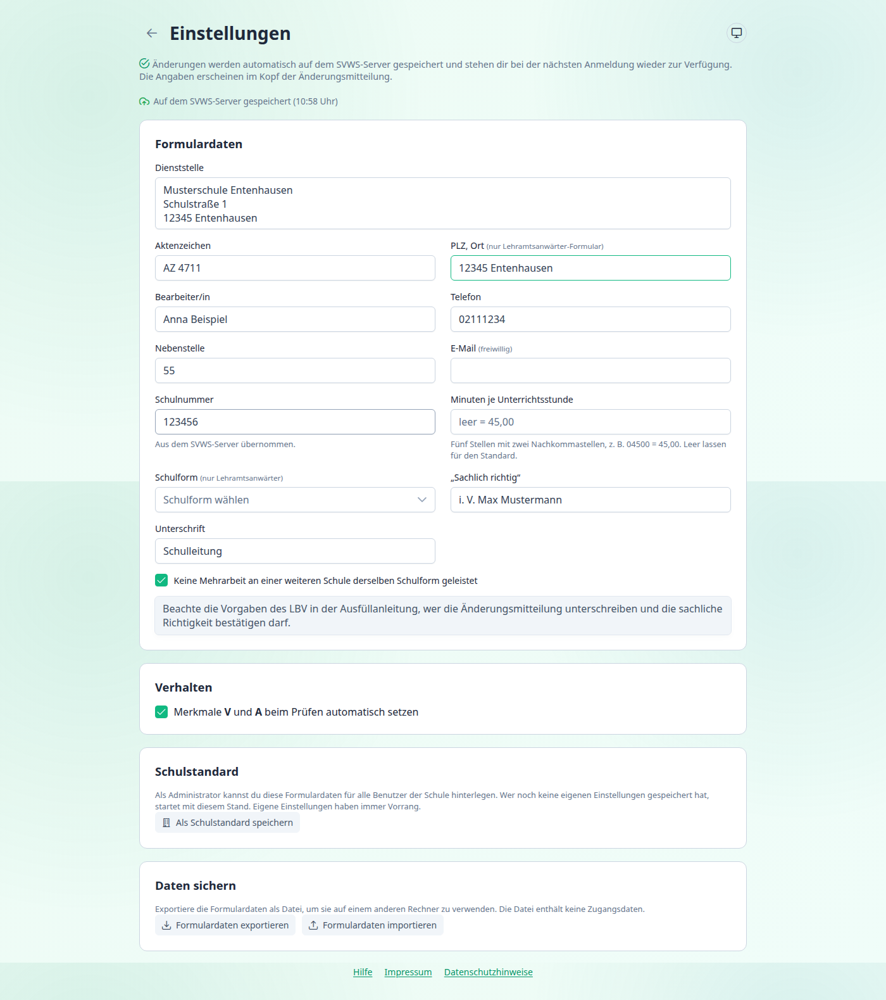

[← Übersicht](index.md)

# Einstellungen

Unter **Einstellungen** trägst du die Angaben ein, die im **Kopf des LBV-Formulars** erscheinen. Das ist meist nur einmal nötig. Änderungen werden **automatisch gespeichert**, mit SVWS-Verbindung auf dem Server, sonst im Browser. Eine Schaltfläche „Speichern“ gibt es nicht.

---

## Formulardaten

Die Felder entsprechen den Feldern des Formulars. Leere Felder bleiben im Formular leer.

| Feld | Eintrag | Hinweis |
|---|---|---|
| **Dienststelle** | Name und Anschrift der Schule, eine Zeile je Angabe | mehrzeilig, Zeilenumbrüche erscheinen im Formular |
| **Aktenzeichen** | Aktenzeichen der Schule | höchstens 35 Zeichen |
| **PLZ, Ort** | Postleitzahl und Ort | nur im Formular für **Lehramtsanwärter**. Das Datum wird automatisch angehängt |
| **Bearbeiter/in** | Name der Person, die die Mitteilung bearbeitet | |
| **Telefon**, **Nebenstelle** | Durchwahl für Rückfragen | im Formular für Lehrkräfte stehen beide zusammen in einem Feld |
| **E-Mail** | freiwillig | nur im Formular für Lehrkräfte |
| **Schulnummer** | sechsstellige Schulnummer | wird aus dem SVWS übernommen und ist dann schreibgeschützt. Muss zwischen 100001 und 199999 liegen |
| **Minuten je Unterrichtsstunde** | fünfstellig mit zwei Nachkommastellen, z. B. `04500` für 45,00 | **leer lassen** für den Standard (45,00). Erlaubt sind Werte über 45,00 bis 120,00 |
| **Schulform** | Schulform für das Formular der **Lehramtsanwärter** | Auswahl nach dem Schlüssel des Formulars, z. B. `07 – öffentliche Gesamtschulen` |
| **„Sachlich richtig“** | Name der Person, die die sachliche Richtigkeit bestätigt | |
| **Unterschrift** | Name der unterschreibenden Person | |
| **Keine Mehrarbeit an einer weiteren Schule …** | Kästchen „nein“ der Frage nach weiterer Mehrarbeit | voreingestellt |

Das **Datum** im Formular ist immer das Datum des Tages, an dem du das PDF erzeugst.

> Beachte die Vorgaben des LBV in der Ausfüllanleitung, wer die Änderungsmitteilung **unterschreiben** und die **sachliche Richtigkeit** bestätigen darf.

---

## Verhalten

**Merkmale V und A beim Prüfen automatisch setzen** (voreingestellt):
Beim Prüfen und Exportieren trägt das Programm das Merkmal **V** oder **A** selbst ein, wenn es sich aus den Stunden ergibt. Die Regeln stehen unter [Mehrarbeit verstehen](mehrarbeit-verstehen.md#merkmale). Schalte die Option aus, wenn du die Merkmale immer selbst setzen möchtest.

---

## Schulstandard

Diesen Abschnitt siehst du nur mit SVWS-Verbindung.

Ein **Administrator** kann die Formulardaten für **alle Benutzer** der Schule hinterlegen:

1. Formulardaten ausfüllen.
2. **Als Schulstandard speichern** wählen.

Wer noch keine eigenen Einstellungen gespeichert hat, startet danach mit diesem Stand. **Eigene Einstellungen haben immer Vorrang.** Ohne Administratorrechte erscheint die Meldung „Nur Administratoren dürfen den Schulstandard festlegen.“

Der Schulstandard enthält keine Daten von Lehrkräften.

---

## Daten sichern

Mit **Formulardaten exportieren** speicherst du die Einstellungen als Datei (`svws-ma2lbv-formulardaten.json`). Mit **Formulardaten importieren** liest du sie auf einem anderen Rechner wieder ein. Die Datei enthält keine Zugangsdaten.

---

## Wo werden die Einstellungen gespeichert?

| Situation | Speicherort |
|---|---|
| mit SVWS-Verbindung | auf dem **SVWS-Server**, deinem Benutzer zugeordnet. Eine Kopie liegt zusätzlich im Browser |
| ohne Verbindung | im **Browser** dieses Rechners |

Ohne Verbindung und mit einem anderen Browser oder Rechner sind die Einstellungen neu einzutragen oder über die Exportdatei zu übernehmen.

---

Weiter mit: [Die Seite „Mehrarbeit abrechnen“](funktionen/index.md)
