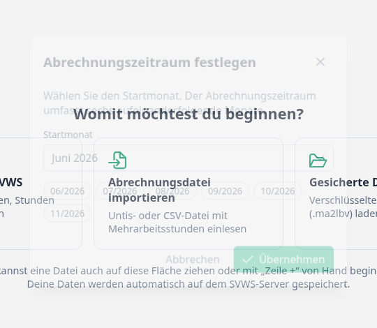
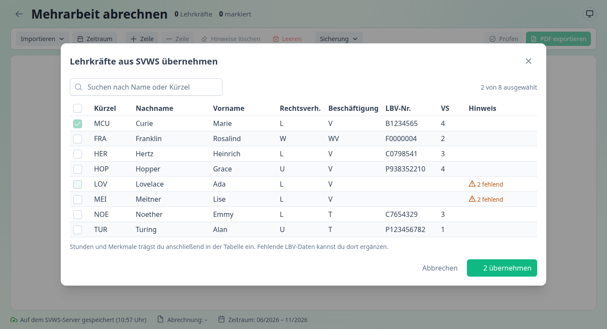
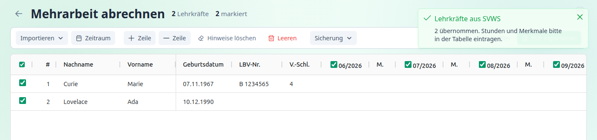

[← Funktionen](index.md) · [← Übersicht](../index.md)

# Daten bereitstellen

Die Tabelle füllst du auf drei Wegen, die sich kombinieren lassen:

1. **Lehrkräfte aus dem SVWS übernehmen** und die Stunden selbst eintragen,
2. eine **Abrechnungsdatei** aus Untis oder einem anderen Programm einlesen,
3. alles **von Hand** eingeben.

Zuerst legst du den Abrechnungszeitraum fest.

---

## Abrechnungszeitraum festlegen

Ein Antrag deckt **sechs aufeinanderfolgende Monate** ab. Beim ersten Öffnen der Abrechnung fragt das Programm danach:

1. Den **Startmonat** wählen. Zur Auswahl stehen die Monate ab Januar vor zwei Jahren bis zum aktuellen Monat. Vorgeschlagen wird der Monat, der fünf Monate vor dem aktuellen liegt, sodass der Zeitraum mit dem laufenden Monat endet.
2. Die Vorschau zeigt die sechs Monate.
3. **Übernehmen** wählen.

Später änderst du den Zeitraum mit **Zeitraum** in der Werkzeugleiste.

> **Achtung:** Beim Ändern des Zeitraums werden alle **Stunden, Merkmale und Hinweise gelöscht**, weil sie zu den bisherigen Monaten gehören. Die Zeilen mit den Lehrkräften bleiben. Der Dialog weist darauf hin, wenn schon Zeilen vorhanden sind.

Wenn du eine **Abrechnungsdatei** einliest, die Monatsangaben enthält, übernimmt das Programm den Zeitraum daraus. Enthält die Datei keine Monate, fragt es nach dem Startmonat.

---

## Lehrkräfte aus dem SVWS übernehmen

Diese Funktion gibt es nur mit **SVWS-Verbindung**. Das Programm liest Name, Geburtsdatum, LBV-Personalnummer, Vergütungsschlüssel und Beschäftigungsverhältnis aus dem SVWS. **Die Mehrarbeitsstunden liefert der SVWS nicht**, die trägst du anschließend ein.

1. **Importieren ▾ → Lehrkräfte aus SVWS** wählen (oder die gleichnamige Kachel).
2. Im Dialog die Lehrkräfte **ankreuzen**. Mit dem Suchfeld filterst du nach Name oder Kürzel, mit dem Kästchen in der Kopfzeile wählst du alle sichtbaren aus.
3. **n übernehmen** wählen.

**Was der Dialog zeigt**

| Spalte | Inhalt |
|---|---|
| Kürzel, Nachname, Vorname | Stammdaten |
| **Rechtsverh.** | Rechtsverhältnis, z. B. `L` Beamte auf Lebenszeit, `W` Beamte auf Widerruf (Lehramtsanwärter), `U`/`B` Angestellte |
| **Beschäftigung** | Beschäftigungsart, z. B. `V` Vollzeit, `T` Teilzeit |
| **LBV-Nr.**, **VS** | LBV-Personalnummer und Vergütungsschlüssel |
| **Hinweis** | „*n* fehlend“, wenn Angaben im SVWS nicht gepflegt sind. „bereits in der Tabelle“, wenn die Lehrkraft schon vorhanden ist (nicht auswählbar) |

**Hinweise zur Auswahl**

- Angezeigt werden nur **sichtbare Lehrkräfte**. Andere Personengruppen erscheinen nicht.
- Rechtsverhältnis und Beschäftigungsart stammen aus dem **aktuellen Schuljahresabschnitt** der Schule.
- Als **Status** trägt das Programm `W` ein, wenn es sich um einen Lehramtsanwärter handelt, sonst die Beschäftigungsart (z. B. `V` oder `T`). → [Die Tabelle](tabelle.md#status)
- Bereits vorhandene Lehrkräfte (gleicher Name und gleiches Geburtsdatum) werden nicht doppelt aufgenommen.
- Fehlende LBV-Personalnummer oder fehlenden Vergütungsschlüssel kannst du in der Tabelle ergänzen. Die Spalte „Hinweis(e)“ nennt, was fehlt.

Die Zeilen werden nach Nachname sortiert. Die Monatsspalten sind leer.

---

## Abrechnungsdatei einlesen

Viele Schulen exportieren die Mehrarbeit aus ihrem Stundenplanprogramm, zum Beispiel aus **GP-Untis**. Das Programm erkennt die beiden bekannten Formate automatisch. → [Importformate](../importformate.md)

So liest du eine Datei ein:

- **Importieren ▾ → Abrechnungsdatei (Untis/CSV)** wählen und die Datei auswählen, **oder**
- die Datei mit der Maus **auf die Tabelle ziehen**.

Erlaubt sind Textdateien (`.txt`, `.csv`).

Dabei gilt:

- Enthält die Tabelle bereits Zeilen, fragt das Programm vor dem **Ersetzen** nach.
- Der Abrechnungszeitraum wird aus der Datei übernommen. Fehlt er, fragt das Programm nach dem Startmonat.
- Nach dem Einlesen sind **alle Zeilen markiert**.
- Auffälligkeiten (zum Beispiel abweichende Monate bei einzelnen Lehrkräften) meldet eine Mitteilung.
- Die Datei wird mit den Zeichensätzen UTF-8 und Windows-1252 gelesen, Umlaute stellen also kein Problem dar. Das Trennzeichen (Komma, Semikolon, Tabulator) wird erkannt.

Eine fehlerhafte Datei lehnt das Programm mit einer Meldung ab (zum Beispiel „Falsches Dateiformat“). → [Fehlermeldungen](../fehlermeldungen.md)

> **Tipp:** Wenn du Lehrkräfte aus Untis *und* weitere aus dem SVWS brauchst, lies **zuerst** die Datei ein und übernimm **danach** die weiteren Lehrkräfte aus dem SVWS. Das Einlesen einer Datei ersetzt die Tabelle.

---

## Von Hand eingeben

Mit **Zeile +** fügst du eine leere Zeile ein und beginnst sofort mit der Eingabe. Alle Spalten sind bearbeitbar. → [Die Tabelle](tabelle.md)

---

Weiter mit: [Die Tabelle](tabelle.md)
