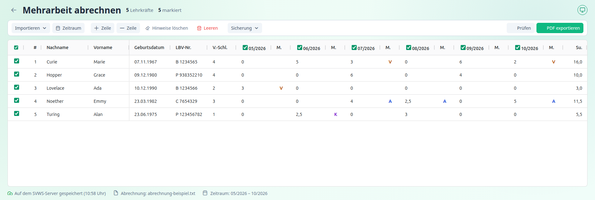
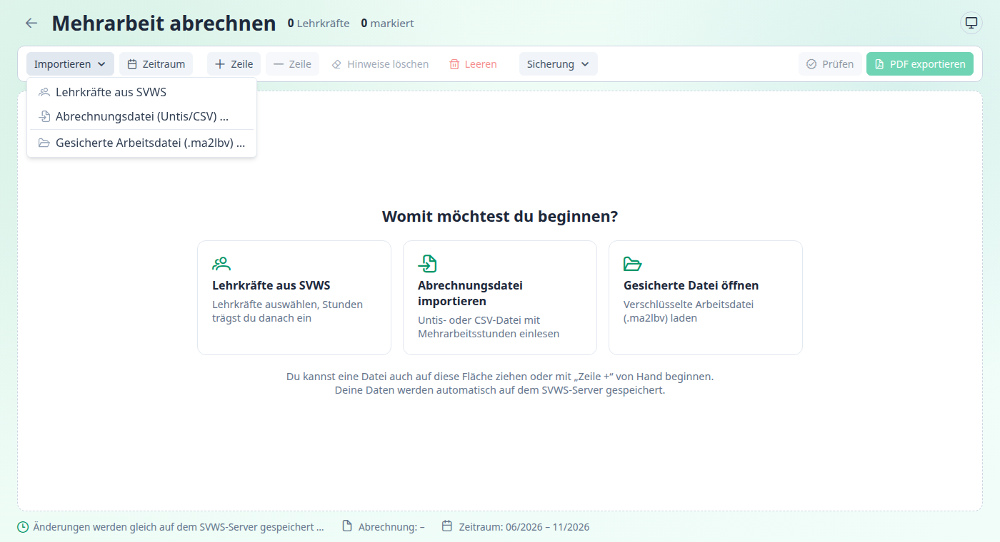
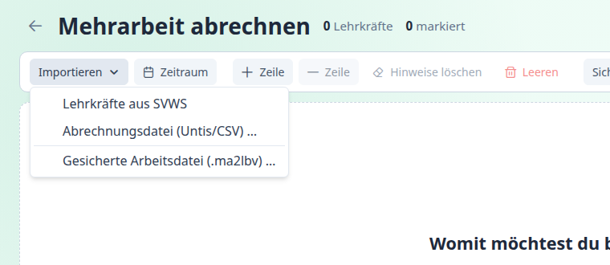

[← Übersicht](../index.md)

# Die Seite „Mehrarbeit abrechnen“

Hier erfasst, prüfst und exportierst du die Mehrarbeit. Du erreichst die Seite über die Kachel **Mehrarbeit abrechnen** auf dem Dashboard.

---

## Aufbau

Die Seite hat vier Bereiche:

1. **Kopfzeile:** Zurück zum Dashboard, Titel und ein Überblick: Anzahl der **Lehrkräfte**, wie viele davon **markiert** sind und wie viele **Fehler** die letzte Prüfung gefunden hat.
2. **Werkzeugleiste** mit den Aktionen (siehe unten).
3. **Tabelle** mit einer Zeile je Lehrkraft. → [Die Tabelle](tabelle.md)
4. **Fußzeile:** Speicherstatus, Name der eingelesenen Abrechnungsdatei und der Abrechnungszeitraum.

Solange die Tabelle leer ist, bietet die Seite drei **Kacheln** zum Beginnen an: *Lehrkräfte aus SVWS*, *Abrechnungsdatei importieren* und *Gesicherte Datei öffnen*. Eine Datei kannst du auch einfach auf die Fläche ziehen.

---

## Werkzeugleiste

| Schaltfläche | Wirkung | Mehr |
|---|---|---|
| **Importieren ▾** | Menü: *Lehrkräfte aus SVWS*, *Abrechnungsdatei (Untis/CSV)*, *Gesicherte Arbeitsdatei (.ma2lbv)* | [Daten bereitstellen](daten-bereitstellen.md) |
| **Zeitraum** | Abrechnungszeitraum (sechs Monate) festlegen oder ändern | [Daten bereitstellen](daten-bereitstellen.md#abrechnungszeitraum-festlegen) |
| **Zeile +** | Neue Zeile nach der aktuellen Zeile einfügen | [Die Tabelle](tabelle.md#zeilen-einfügen-und-löschen) |
| **Zeile –** | Aktuelle Zeile löschen | |
| **Hinweise löschen** | Alle Texte der Spalte „Hinweis(e)“ entfernen | |
| **Leeren** | Alle Zeilen verwerfen (nach Rückfrage). Der Zeitraum bleibt | |
| **Sichern** (ohne Verbindung) | Tabelle in eine verschlüsselte Datei sichern | [Speichern](speichern.md) |
| **Sicherung ▾** (mit Verbindung) | Menü: *Jetzt auf dem SVWS-Server speichern*, *Sicherung in Datei speichern* | [Speichern](speichern.md) |
| **Prüfen** | Markierte Zeilen prüfen, ohne ein PDF zu erzeugen | [Prüfen und exportieren](pruefen-und-exportieren.md) |
| **PDF exportieren ▾** | Menü: *PDF-Dateien speichern*, *Zum Drucken öffnen* | [Prüfen und exportieren](pruefen-und-exportieren.md#pdf-erzeugen) |

Die Menüs öffnen sich mit einem Klick:

---

## Tastenkürzel

| Taste | Wirkung |
|---|---|
| **Strg + A** | alle Zeilen markieren |
| **Strg + K** | keine Zeile markieren |
| **Strg + U** | Markierung umkehren |
| **Strg + S** | speichern. Mit SVWS-Verbindung sofort auf dem Server, sonst öffnet sich der Dialog „Arbeitsdatei sichern“ |
| **Enter** / Doppelklick | Zelle bearbeiten, mit **Enter** übernehmen, mit **Esc** verwerfen |
| **Tab** | zur nächsten Zelle |
| **Strg + Plus**, **Strg + Minus**, **Strg + 0** | Anzeige vergrößern, verkleinern, zurücksetzen (im Browser über die Browser-Zoomfunktion) |

Die Kürzel für die Markierung gelten nicht, solange du in einem Textfeld schreibst.

---

Weiter mit: [Daten bereitstellen](daten-bereitstellen.md)
