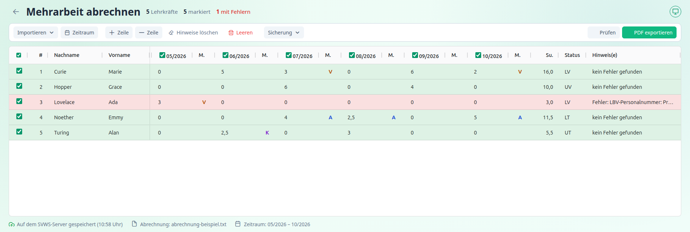
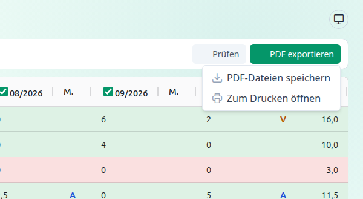
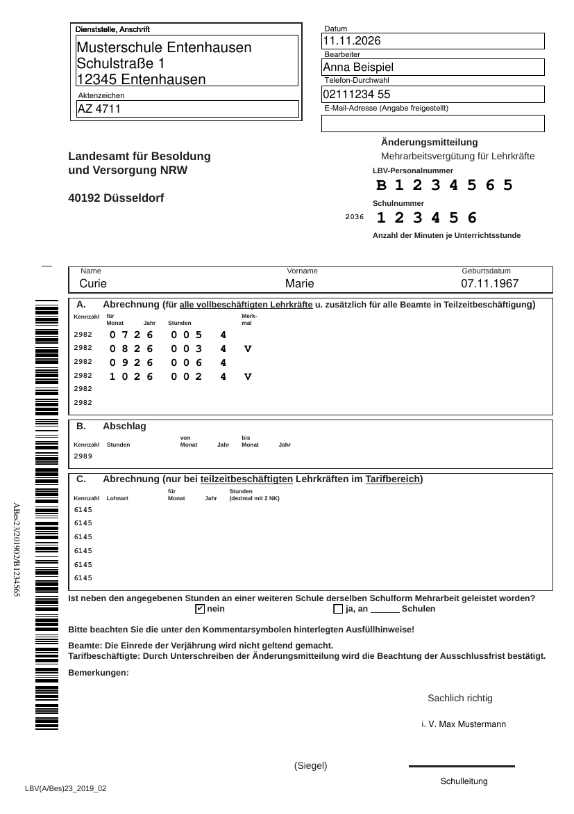

[← Funktionen](index.md) · [← Übersicht](../index.md)

# Prüfen und exportieren

---

## Prüfen

Mit **Prüfen** kontrollierst du die **markierten** Zeilen, ohne ein PDF zu erzeugen. Das Ergebnis steht in der Spalte **Hinweis(e)**:

- **kein Fehler gefunden**: Die Zeile ist fehlerfrei, die Zeile wird grün.
- **Fehler: …**: Die Zeile ist rot. Der Text nennt den **ersten** Fehler. Bei weiteren Fehlern steht dahinter „(+n)“. Fährst du mit der Maus über das Feld, siehst du **alle Fehler**.

Behebt eine Eingabe den Fehler, prüfst du erneut. Alle Meldungen mit Ursache und Abhilfe stehen unter [Fehlermeldungen](../fehlermeldungen.md).

### Was geprüft wird

**Für die Schule** (Einstellungen)

- Schulnummer: sechs Ziffern
- Minuten je Unterrichtsstunde, falls angegeben
- Schulform, wenn ein Formular für Lehramtsanwärter nötig ist

**Für jede Lehrkraft**

- Nachname, Vorname und ein gültiges Geburtsdatum
- **LBV-Personalnummer**: Aufbau und **Prüfziffer**. Die Nummer muss zum Formular passen. → [Mehrarbeit verstehen](../mehrarbeit-verstehen.md#die-lbv-personalnummer)
- die Zuordnung beamtet / tarifbeschäftigt muss möglich sein

**Für jeden Monat mit Stunden**

- Vergütungsschlüssel im zulässigen Bereich
- Merkmal passend zum Abschnitt und zu den Stunden
- Stundenzahl innerhalb der Grenzen des Formulars
- der Monat ist gültig und liegt **nicht in der Zukunft** (der laufende Monat ist erlaubt)

Die Summe aller Stunden muss größer als 0 sein („keine Mehrarbeit“).

### Automatische Merkmale

Ist die Einstellung **Merkmale V und A automatisch setzen** an, trägt das Programm beim Prüfen die Merkmale in der Tabelle ein, bevor es prüft. Du siehst das Ergebnis in der Tabelle und kannst es korrigieren. → [Mehrarbeit verstehen](../mehrarbeit-verstehen.md#merkmale)

---

## PDF erzeugen

Mit **PDF exportieren ▾** erzeugst du die Änderungsmitteilung.

Vor dem Erzeugen werden die markierten Zeilen **geprüft**. Für fehlerfreie Zeilen entsteht ein PDF, fehlerhafte Zeilen werden übersprungen und in der Spalte „Hinweis(e)“ erklärt. Eine Mitteilung nennt, wie viele Zeilen erzeugt wurden und wie viele Fehler hatten.

### PDF-Dateien speichern

- Eine fehlerfreie Zeile ergibt **eine PDF-Datei**: `LBV_<Nachname>_<LBV-Nr.>_<JJMM>-<JJMM>.pdf`, zum Beispiel `LBV_Curie_B1234565_2606-2610.pdf`. Die Zahlen sind der erste und der letzte Monat mit Mehrarbeit (Jahr und Monat).
- Mehrere Zeilen ergeben ein **ZIP** mit einer PDF je Lehrkraft: `LBV_Mehrarbeit_<JJMM>-<JJMM>.zip`.

In der Spalte „Hinweis(e)“ steht danach „Export nach <Dateiname>“.

### Zum Drucken öffnen

Alle fehlerfreien Zeilen werden zu **einem PDF** zusammengefasst und in einem neuen Fenster geöffnet. Von dort druckst du in einem Zug. In der Spalte „Hinweis(e)“ steht „Export nach Druckansicht“.

> Drucke das Formular auf **A4 in Originalgröße (100 %)**. Wähle keine Option wie „An Seite anpassen“, damit Barcode und Felder an der richtigen Stelle sitzen.

---

## Das Formular

Das Programm füllt das **Formular des LBV** aus. Es gibt zwei Ausführungen, die automatisch passend gewählt werden:

| Formular | Für | Abschnitte |
|---|---|---|
| **Änderungsmitteilung Mehrarbeitsvergütung für Lehrkräfte** | Lehrkräfte (Status V oder T) | **A** (Vollzeit, Beamte in Teilzeit), **C** (Tarifbeschäftigte in Teilzeit) |
| **Änderungsmitteilung VNU/VZU** | Lehramtsanwärter und Studienreferendare (Status W) | **B** (Abrechnung je Schulform) |

Der Abschnitt „Abschlag“ (Kennzahl 2989 bzw. 2E) wird **nicht** ausgefüllt.

**Was das Programm einträgt**

| Bereich | Quelle |
|---|---|
| Dienststelle, Aktenzeichen, Bearbeiter/in, Telefon, E-Mail, Schulnummer, Minuten je Unterrichtsstunde, „Sachlich richtig“, Unterschrift | [Einstellungen](../einstellungen.md) |
| **Datum** | Tag der Erzeugung |
| Name, Vorname, Geburtsdatum, LBV-Personalnummer | Tabelle |
| Abrechnungszeilen (Monat, Stunden, Vergütungsschlüssel, Merkmal oder Lohnart) | Tabelle, je Monat mit Stunden eine Zeile |
| „Keine Mehrarbeit an weiterer Schule“ | Einstellung |
| **Barcode** | automatisch aus der LBV-Personalnummer |

Der **Barcode** am linken Rand enthält die Formularkennung und die LBV-Personalnummer. Er dient der maschinellen Verarbeitung beim LBV. Das Formular für Lehramtsanwärter trägt nur die feste Formularkennung des LBV. Eine Personalnummer wird dort nicht als Barcode eingetragen.

Die Namen schreibt das Programm in gemischter Schreibweise. Nur vollständig groß geschriebene Namen werden umgewandelt (`MÜLLER` wird zu `Müller`).

### Hinweise zur Ansicht am Bildschirm

- In **gespeicherten PDF-Dateien** siehst du in leeren Zeilen Platzhalterzeichen (`#`) und eine Legende zu den Vergütungsschlüsseln. Beide erscheinen **nicht im Ausdruck**. In der „Druckansicht“ sind sie nicht enthalten.
- Der Barcode wird als Grafik eingefügt und ist auch am Bildschirm sichtbar.
- Das Formular ist ein Ausdruckbogen. **Prüfe ihn vor dem Versand** auf Vollständigkeit.

---

## Nach dem Export

1. Formular **ausdrucken**.
2. Durch die berechtigten Personen **unterschreiben** und mit dem **Siegel** der Schule versehen.
3. An das **LBV** senden. Beachte die Ausfüllanleitung des LBV für Änderungsmitteilungen.

---

Weiter mit: [Speichern](speichern.md)
