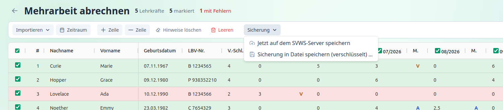
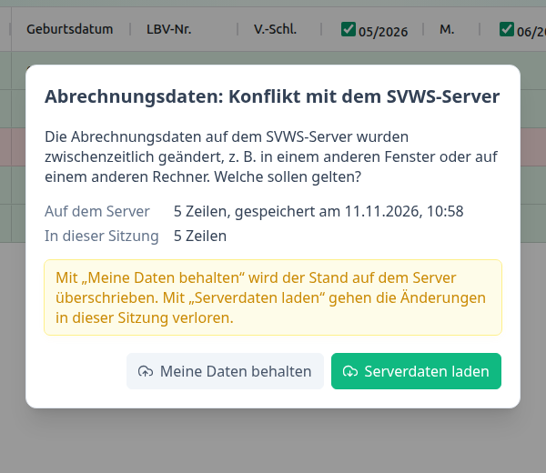
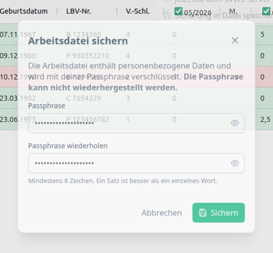

[← Funktionen](index.md) · [← Übersicht](../index.md)

# Speichern

Deine Daten bestehen aus den **Abrechnungsdaten** (Tabelle, Zeitraum, Monatsauswahl) und den **Einstellungen**. Wie sie gespeichert werden, hängt davon ab, ob du mit dem SVWS-Server verbunden bist.

| | Mit SVWS-Verbindung | Ohne Verbindung |
|---|---|---|
| **Abrechnungsdaten** | automatisch auf dem SVWS-Server | nur im Arbeitsspeicher. **sichere** sie in eine Datei |
| **Einstellungen** | automatisch auf dem SVWS-Server | im Browser dieses Rechners |
| **Sicherungsdatei** | zusätzlich möglich, als Sicherung | die einzige Möglichkeit zum Aufbewahren der Tabelle |

---

## Mit SVWS-Verbindung: automatisch auf dem Server

Du musst nichts tun. Jede Änderung wird nach kurzer Ruhe (etwa anderthalb Sekunden) **automatisch auf dem SVWS-Server gespeichert**. Beim nächsten Anmelden, auch an einem anderen Rechner, sind deine Daten wieder da.

Die **Statusanzeige** unten links zeigt den Stand:

| Anzeige | Bedeutung |
|---|---|
| Auf dem SVWS-Server gespeichert (10:57 Uhr) | alles gespeichert |
| Änderungen werden gleich auf dem SVWS-Server gespeichert … | eine Änderung wartet, wird gleich gesendet |
| Speichere auf dem SVWS-Server … | wird gerade gesendet |
| Nicht gespeichert: … **Erneut versuchen** | das Speichern ist fehlgeschlagen, zum Beispiel weil der Server nicht erreichbar ist. Deine Änderungen bleiben im Programm. Mit **Erneut versuchen** sendest du sie noch einmal |
| Die Daten auf dem SVWS-Server wurden geändert. Bitte entscheiden. | Konflikt, siehe unten |

Sofort speichern kannst du mit **Strg + S** oder über **Sicherung ▾ → Jetzt auf dem SVWS-Server speichern**.

**Wichtig zu wissen**

- Auf dem Server liegt **ein aktueller Stand je Benutzer**. Es gibt keinen Verlauf früherer Stände.
- Andere Benutzer sehen deine Abrechnungsdaten nicht.
- Die Daten liegen auf dem Server **nicht zusätzlich verschlüsselt**. → [Datenschutzhinweise](../datenschutz.md)
- Mit **Leeren** speicherst du einen leeren Stand. Der Server kennt kein Löschen.

### Konflikt: Daten wurden zwischenzeitlich geändert

Hast du die Abrechnung in **zwei Fenstern** oder auf **zwei Rechnern** gleichzeitig geöffnet, kann der Stand auf dem Server von deinem abweichen. Das Programm bemerkt das **vor dem Speichern** und fragt:

| Wahl | Wirkung |
|---|---|
| **Serverdaten laden** | Der Stand vom Server gilt. Deine Änderungen in dieser Sitzung gehen verloren |
| **Meine Daten behalten** | Dein Stand gilt und überschreibt den Server |

Bis zur Entscheidung wird nichts überschrieben. Dieselbe Frage erscheint beim Anmelden, wenn auf dem Server bereits Abrechnungsdaten liegen und in dieser Sitzung ebenfalls Daten vorhanden sind. Einzelne Zeilen werden nicht zusammengeführt.

> Arbeite am besten immer nur in **einem** Fenster.

---

## Sicherungsdatei (verschlüsselt)

Die Sicherungsdatei (`.ma2lbv`) enthält deine **Tabelle** mit Zeitraum und Monatsauswahl. Sie ist mit einer **Passphrase** verschlüsselt, die nur du kennst. Du brauchst sie

- **ohne SVWS-Verbindung**, um die Tabelle aufzubewahren,
- **mit Verbindung** als zusätzliche Sicherung.

Die Datei enthält **nicht** deine Einstellungen und **keine** Zugangsdaten.

### Sichern

1. Ohne Verbindung **Sichern**, mit Verbindung **Sicherung ▾ → Sicherung in Datei speichern (verschlüsselt)** wählen (oder **Strg + S** ohne Verbindung).
2. Eine **Passphrase** eingeben und **wiederholen**. Sie muss mindestens **8 Zeichen** lang sein. Ein ganzer Satz ist besser als ein einzelnes Wort.
3. **Sichern** wählen. Der Browser speichert die Datei `mehrarbeit_<JJMM>-<JJMM>.ma2lbv`.

> **Die Passphrase kann nicht wiederhergestellt werden.** Wer sie vergisst, kann die Datei nicht mehr öffnen. Bewahre sie sicher auf.

### Öffnen

1. **Importieren ▾ → Gesicherte Arbeitsdatei (.ma2lbv)** wählen, oder die Kachel **Gesicherte Datei öffnen**, oder die Datei auf die Tabelle ziehen.
2. Die **Passphrase** eingeben und **Öffnen** wählen.

Bei falscher Passphrase bleibt der Dialog offen, und du kannst es erneut versuchen. Die Tabelle bleibt unverändert. Enthält die Tabelle ungesicherte Änderungen, fragt das Programm vorher nach, denn **Öffnen ersetzt** die Tabelle.

In der Fußzeile steht ohne Verbindung der Name der Arbeitsdatei. Ein **Stern (\*)** dahinter bedeutet: Es gibt Änderungen, die noch nicht gesichert sind.

---

## Schutz vor Datenverlust

Das Programm warnt, bevor etwas verloren geht. Gemeint sind immer **Abrechnungsdaten und Einstellungen**.

| Situation | Verhalten |
|---|---|
| Browser **schließen oder neu laden**, Programm beenden | Warnung, wenn etwas nicht gesichert ist. Mit Verbindung ist das der Fall, solange Änderungen noch nicht auf dem Server liegen. Ohne Verbindung: solange die Tabelle nicht in einer Datei gesichert ist |
| **Abrechnung** verlassen (Zurück zum Dashboard) | Mit Verbindung wird zuerst gespeichert, gefragt wird nur bei Fehlern oder Konflikt. Ohne Verbindung fragt das Programm bei ungesicherter Tabelle nach |
| **Einstellungen** verlassen | Mit Verbindung nur bei Speicherfehlern oder Konflikt. Ohne Verbindung liegen sie automatisch im Browser, dort gibt es nichts zu warnen |
| **Abmelden** | siehe [Verbindung](../verbindung.md#abmelden) |

Beim Verlassen der Abrechnung ohne Verbindung bleibt die Tabelle im Programm erhalten, **solange du es nicht schließt oder dich abmeldest**.

---

Zurück zur [Übersicht](../index.md)
