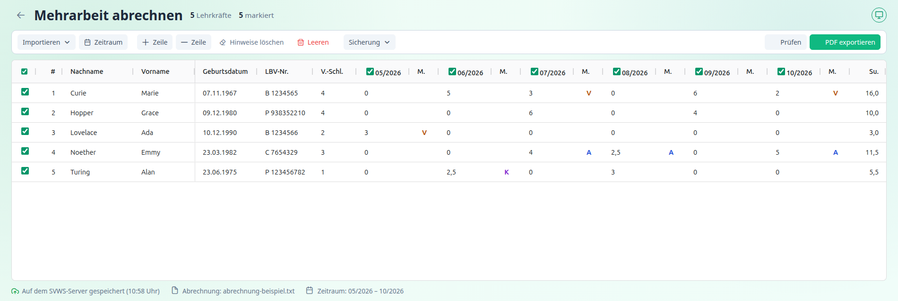

[← Funktionen](index.md) · [← Übersicht](../index.md)

# Die Tabelle

Die Tabelle enthält **eine Zeile je Lehrkraft**. Alle Felder außer der Nummer und der Summe lassen sich direkt bearbeiten.

---

## Spalten

| Spalte | Inhalt | Eingabe |
|---|---|---|
| ☑ (erste Spalte) | Zeile für Prüfung und Export **markiert** | Kästchen anklicken. Das Kästchen in der Kopfzeile markiert alle |
| **#** | laufende Nummer | nicht bearbeitbar |
| **Nachname**, **Vorname** | Name der Lehrkraft | Text |
| **Geburtsdatum** | `TT.MM.JJJJ` | muss ein gültiges Datum sein |
| **LBV-Nr.** | LBV-Personalnummer | Leerzeichen sind erlaubt (`B 1234565`), Kleinbuchstaben werden zu Großbuchstaben |
| **V.-Schl.** | Vergütungsschlüssel | 1 bis 4, bei Lehramtsanwärtern 1 bis 8 |
| **Monate** (6 Spaltenpaare) | je Monat die **Stunden** und das **Merkmal** (Spalte „M.“) | siehe unten |
| **Su.** | Summe der Stunden der berücksichtigten Monate | nicht bearbeitbar, eine Nachkommastelle |
| **Status** | `V`, `T` oder `W` | siehe unten |
| **Hinweis(e)** | Ergebnis von Prüfung und Export | nicht bearbeitbar |

Eine Zelle bearbeitest du mit **Doppelklick** oder indem du die Zelle auswählst und **Enter** drückst oder einfach zu tippen beginnst. **Enter** übernimmt die Eingabe, **Esc** verwirft sie.

Fährst du mit der Maus über eine Spaltenüberschrift, erscheint ein kurzer Erklärungstext.

---

## Monate und Stunden

Über jedem Monat steht ein Kästchen mit dem Monat (z. B. **06/2026**).

- **Angehakt:** Der Monat wird in die Summe und in den Export einbezogen.
- **Nicht angehakt:** Der Monat wird grau dargestellt und **ignoriert**. So lassen sich einzelne Monate aus einem Antrag herausnehmen, ohne die Stunden zu löschen.

**Stunden** gibst du als Zahl ein, mit Komma oder Punkt, höchstens zwei Nachkommastellen (`3`, `2,5`). Andere Eingaben weist das Programm mit „Bitte Stunden als Zahl eingeben, z. B. 3 oder 2,5.“ zurück.

Monate ohne Stunden oder mit 0 Stunden erscheinen nicht im Formular.

---

## Merkmale

Das **Merkmal** steht in der Spalte „M.“ rechts neben den Stunden des Monats. Es ist farbig hervorgehoben.

| Merkmal | Bedeutung | Gilt für |
|---|---|---|
| **V** | weniger als vier vergütungsfähige Stunden | Vollzeit, Abschnitt A |
| **A** | anteilige Besoldung bei Teilzeit | Teilzeit (Beamte), Abschnitt A |
| **K** | Beteiligung an Klassenfahrten (Lohnart 5006) | Teilzeit im Tarifbereich, Abschnitt C |

Welche Merkmale erlaubt sind, hängt von der Lehrkraft ab. → [Mehrarbeit verstehen](../mehrarbeit-verstehen.md#merkmale)

- Trägst du ein unzulässiges Merkmal ein, erscheint eine Meldung, und das Merkmal wird gelöscht.
- Mit der Einstellung **Merkmale V und A automatisch setzen** (voreingestellt) trägt das Programm sie beim Prüfen und Exportieren selbst ein. → [Einstellungen](../einstellungen.md#verhalten)
- Beim Einlesen einer Abrechnungsdatei werden vorhandene Merkmale übernommen, Kleinbuchstaben werden zu Großbuchstaben.

---

## Status

Der Status entscheidet über die Zuordnung zum Formular:

| Status | Bedeutung |
|---|---|
| **V** | Vollzeit |
| **T** | Teilzeit |
| **W** | Lehramtsanwärter (eigenes Formular) |

Das Programm wertet den Status so aus: Enthält er den Buchstaben **T**, gilt die Lehrkraft als **Teilzeit**, sonst als **Vollzeit**. Enthält er **W**, wird das Formular für Lehramtsanwärter verwendet.

Aus Dateien können längere Kürzel kommen (z. B. `LT`, `UV`). Das ist in Ordnung, solange `T` für Teilzeit und `W` für Lehramtsanwärter darin vorkommt.

> **Kontrolliere den Status**, besonders bei Beschäftigungsarten wie Altersteilzeit oder nebenberuflich Beschäftigten, bei denen die Zuordnung zu Voll- und Teilzeit nicht immer eindeutig ist.

Zusammen mit der LBV-Personalnummer ergibt der Status den **Formularabschnitt**. → [Mehrarbeit verstehen](../mehrarbeit-verstehen.md#welche-lehrkraft-gehört-in-welchen-abschnitt)

---

## Markieren

Nur **markierte** Zeilen werden geprüft und exportiert. Nicht markierte Zeilen erscheinen abgeblendet.

- Kästchen in der **Kopfzeile**: alle markieren oder die Markierung aufheben. Sind nur einige Zeilen markiert, steht es im Zwischenzustand.
- **Strg + A** alle, **Strg + K** keine, **Strg + U** Markierung umkehren.

---

## Zeilen einfügen und löschen

- **Zeile +** fügt eine neue Zeile **nach der Zeile ein, in der du zuletzt gearbeitet hast**, sonst am Ende. Die Eingabe beginnt sofort im Feld „Nachname“.
- **Zeile –** löscht die Zeile, in der sich die Auswahl befindet. Klicke vorher eine Zelle der Zeile an.
- **Leeren** verwirft nach Rückfrage **alle** Zeilen.
- **Hinweise löschen** entfernt die Texte der Spalte „Hinweis(e)“.

---

## Farben in der Tabelle

| Darstellung | Bedeutung |
|---|---|
| Zeile **rot** | Die Prüfung hat Fehler gefunden |
| Zeile **grün** | Die Prüfung war fehlerfrei oder das PDF wurde erzeugt |
| Zeile **abgeblendet** | Die Zeile ist nicht markiert |
| Spalte **grau** | Der Monat ist nicht angehakt |

Farben allein sind nie die einzige Information: Das Ergebnis steht immer auch als Text in der Spalte „Hinweis(e)“.

---

Weiter mit: [Prüfen und exportieren](pruefen-und-exportieren.md)
