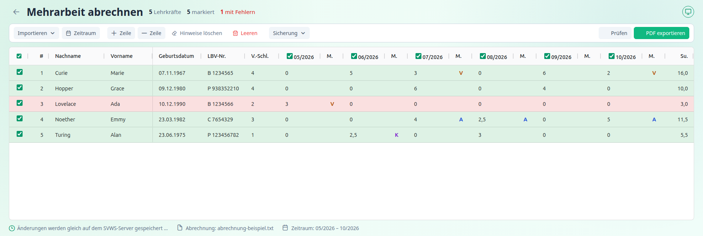

  

---

# Bedienungsanleitung SVWS-MA2LBV

SVWS-MA2LBV erstellt die **Änderungsmitteilung zur Mehrarbeitsvergütung** für das Landesamt für Besoldung und Versorgung NRW (LBV). Das Programm löst das bisherige Programm **MA2** (vormals MA2LBV) ab und arbeitet mit dem **SVWS-Server** deiner Schule zusammen.

Du stellst die Mehrarbeitsstunden der Lehrkräfte bereit, das Programm prüft sie nach den Regeln des LBV und füllt das Formular des LBV als PDF aus.

---

## Schnellstart

1. **Programm starten** und sich mit dem SVWS-Server verbinden. Das geht auch ohne Verbindung. → [Installation](installation.md), [Verbindung](verbindung.md)
2. **Einstellungen ausfüllen**, einmalig: Schulnummer, Dienststelle, Aktenzeichen, Bearbeiter/in und Unterschrift. → [Einstellungen](einstellungen.md)
3. **Mehrarbeit abrechnen** öffnen und den **Abrechnungszeitraum** (sechs Monate) festlegen. → [Daten bereitstellen](funktionen/daten-bereitstellen.md)
4. **Lehrkräfte aus dem SVWS übernehmen** und Stunden eintragen, **oder** eine Abrechnungsdatei aus Untis einlesen.
5. **Prüfen**. Fehler zeigt die Spalte „Hinweis(e)“. → [Prüfen und exportieren](funktionen/pruefen-und-exportieren.md)
6. **PDF exportieren**, ausdrucken, unterschreiben und an das LBV senden.

Mit bestehender SVWS-Verbindung speichert das Programm deine Daten automatisch auf dem Server und lädt sie beim nächsten Anmelden wieder. → [Speichern](funktionen/speichern.md)

---

## Inhaltsverzeichnis

| Kapitel | Inhalt |
|---|---|
| [Installation](installation.md) | Windows, Linux, Web-Version auf dem SVWS-Server |
| [Verbindung zum SVWS-Server](verbindung.md) | Anmelden, Arbeiten ohne Verbindung, Abmelden |
| [Einstellungen](einstellungen.md) | Formulardaten der Schule, Schulstandard, Verhalten |
| **Funktionen** | |
| [Die Seite „Mehrarbeit abrechnen“](funktionen/index.md) | Aufbau, Werkzeugleiste, Tastenkürzel |
| [Daten bereitstellen](funktionen/daten-bereitstellen.md) | Zeitraum, Lehrkräfte aus SVWS, Abrechnungsdatei, Handeingabe |
| [Die Tabelle](funktionen/tabelle.md) | Spalten, Eingabe, Merkmale, Markieren |
| [Prüfen und exportieren](funktionen/pruefen-und-exportieren.md) | Prüfung, PDF-Formular, Drucken |
| [Speichern](funktionen/speichern.md) | Speichern auf dem Server, Sicherungsdatei, Konflikte |
| **Hintergrund** | |
| [Mehrarbeit verstehen](mehrarbeit-verstehen.md) | Formularabschnitte, Vergütungsschlüssel, Merkmale, LBV-Personalnummer |
| [Importformate](importformate.md) | Aufbau der Abrechnungsdateien, Export aus Untis |
| [Fehlermeldungen](fehlermeldungen.md) | Alle Meldungen mit Ursache und Abhilfe |
| [Umstieg von MA2](umstieg-von-ma2.md) | Was ist neu, was entfällt |
| [Hilfe und Fragen](hilfe.md) | Häufige Fragen, Support |
| [Datenschutzhinweise](datenschutz.md) | Welche Daten wo gespeichert werden |

---

## Über diese Anleitung

Die Anleitung richtet sich an Personen, die an der Schule die Mehrarbeit mit dem LBV abrechnen, zum Beispiel in Schulleitung oder Sekretariat, sowie an Betreuerinnen und Betreuer der Schul-IT. Technische Hintergründe stehen im [Entwicklerverzeichnis](adr/).

> **Wichtig:** Das Formular des LBV wird vom Programm nur ausgefüllt. Für die Richtigkeit der Angaben und die Unterschrift bist du verantwortlich. Beachte die **Ausfüllanleitung des LBV** für Änderungsmitteilungen.

Du kennst das bisherige Programm MA2? Dann beginne mit dem Kapitel [Umstieg von MA2](umstieg-von-ma2.md).
