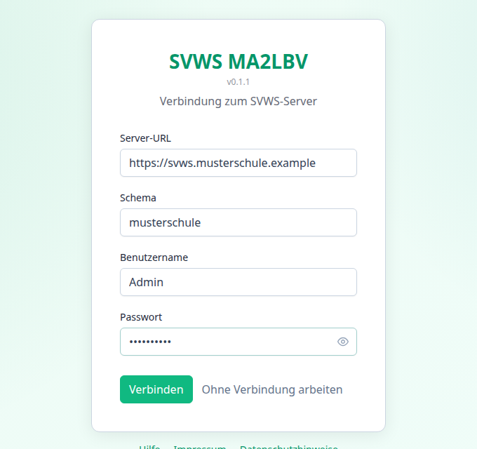
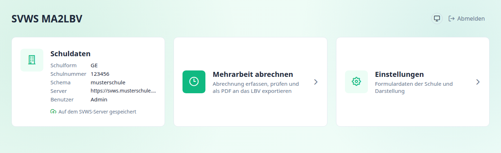

[← Übersicht](index.md)

# Verbindung zum SVWS-Server

Beim Start öffnet sich die Anmeldeseite. Du kannst dich mit dem SVWS-Server deiner Schule verbinden oder ohne Verbindung arbeiten.

---

## Anmelden

Die vier Angaben erhältst du von deiner Schulverwaltung oder deiner Schul-IT.

| Feld | Bedeutung | Beispiel |
|---|---|---|
| **Server-URL** | Adresse des SVWS-Servers mit Protokoll und gegebenenfalls Port | `https://svws.meine-schule.de` |
| **Schema** | Datenbank-Mandant deiner Schule auf dem Server | `meineschule` |
| **Benutzername** | Dein SVWS-Benutzername | |
| **Passwort** | Dein SVWS-Passwort. Mit dem Auge-Symbol lässt es sich anzeigen | |

Mit **Verbinden** meldest du dich an. Danach erscheint das Dashboard. Bei falschen Angaben erscheint die Meldung „Verbindung fehlgeschlagen. Bitte URL, Schema und Zugangsdaten prüfen.“

> Dein Passwort wird **nur im Arbeitsspeicher** gehalten. Es wird weder im Browser noch in einer Datei gespeichert. Nach einem Neustart oder Neuladen musst du dich erneut anmelden.

### Was nach dem Anmelden passiert

- Das Programm lädt deine **Einstellungen** und deine **Abrechnungsdaten** vom Server, falls dort welche liegen. Du arbeitest also dort weiter, wo du aufgehört hast. → [Speichern](funktionen/speichern.md)
- Die **Schulnummer** der Schule wird aus dem SVWS übernommen.
- Ist der Server nicht erreichbar oder meldet er einen Fehler, bleibt die Arbeit ohne Server möglich. Die Statusanzeige zeigt den Fehler mit der Schaltfläche **Erneut versuchen**.

---

## Ohne Verbindung arbeiten

Mit **Ohne Verbindung arbeiten** gelangst du zum Dashboard, ohne sich anzumelden.

Möglich bleiben:

- Daten **von Hand** eingeben,
- eine **Abrechnungsdatei** (Untis oder CSV) einlesen,
- **prüfen** und **PDF-Formulare erzeugen**,
- die Tabelle in einer **verschlüsselten Sicherungsdatei** speichern und wieder öffnen.

Nicht möglich ist die Übernahme von **Lehrkräften aus dem SVWS**, weil dafür die Verbindung nötig ist.

> Ohne Verbindung speichert das Programm deine Abrechnungsdaten **nicht automatisch**. Sichere die Tabelle mit **Sichern** in eine Datei, bevor du das Programm schließt. Das Programm weist dich darauf hin, wenn etwas ungesichert ist.

---

## Das Dashboard

Nach der Anmeldung oder ohne Verbindung siehst du drei Kacheln:

| Kachel | Inhalt |
|---|---|
| **Schuldaten** | Schulform, Schulnummer, Schema, Server und Benutzer. Darunter zeigt die Statusanzeige, ob deine Daten auf dem SVWS-Server gespeichert sind. Ohne Verbindung steht dort „Keine SVWS-Verbindung“ |
| **Mehrarbeit abrechnen** | Öffnet die Abrechnung. → [Funktionen](funktionen/index.md) |
| **Einstellungen** | Formulardaten der Schule und Verhalten. → [Einstellungen](einstellungen.md) |

Oben rechts wechselt der runde Knopf zwischen den Darstellungen **System**, **Hell** und **Dunkel**. Die Einstellung gilt für alle SVWS-Tools im selben Browser.

Unten auf der Anmeldeseite findest du **Hilfe**, **Impressum** und **Datenschutzhinweise**.

---

## Abmelden

Mit **Abmelden** (ohne Verbindung: **Zur Anmeldung**) verlässt du das Programm sicher:

1. Wartende Änderungen werden zuerst auf dem SVWS-Server gespeichert.
2. Gelingt das nicht, oder ist ohne Verbindung die Tabelle nicht in einer Datei gesichert, fragt das Programm nach, ob du dich trotzdem abmelden willst.
3. Danach werden **alle Daten aus dem Programm entfernt**: Tabelle, Zeitraum und, bei bestehender Verbindung, die Einstellungen im Arbeitsspeicher. So sieht die nächste Person am selben Rechner nichts von deinen Daten.

Deine Daten bleiben auf dem SVWS-Server erhalten und stehen bei der nächsten Anmeldung wieder bereit.

---

Weiter mit: [Einstellungen](einstellungen.md)
